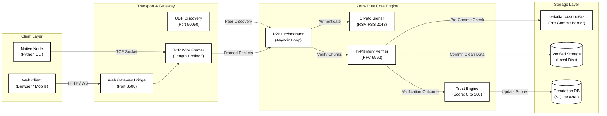
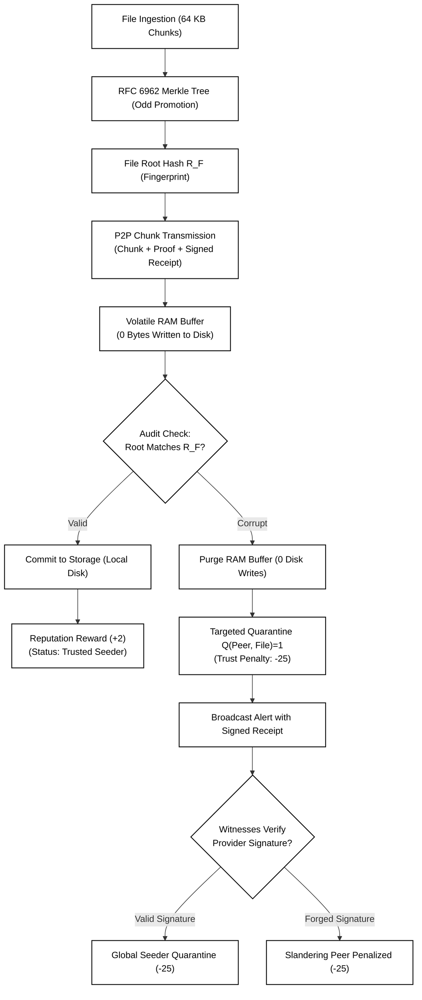

# Zero-Trust P2P File Sharing Diagrams

This directory contains the two official, publication-grade, minimalist black-and-white diagrams for the Zero-Trust P2P File Sharing project. Designed specifically for academic papers (IEEE format) and slide presentations.

---

## 1. System Architecture

- **Draw.io File:** [`system_architecture.drawio`](system_architecture.drawio)
- **Mermaid Source:** [`system_architecture.mmd`](system_architecture.mmd)

### Architecture Overview
- **Client Layer:** Universal Web Client (Browser/Mobile via QR code) and Native Node (Python CLI).
- **Transport & Gateway:** Streamlit Web Gateway (:8500), Length-prefixed TCP Wire Framer, and UDP LAN Beacon Discovery (:50050).
- **Zero-Trust Core Engine:** Asyncio P2P Orchestrator, RSA-PSS 2048-bit Crypto Signer, RFC 6962 In-Memory Merkle Verifier, and Dynamic Trust Engine (0-100).
- **Storage Layer:** Volatile RAM Buffer (pre-commit barrier), Verified Disk Storage, and SQLite WAL Database.

---

## 2. Security & Reputation Lifecycle

- **Draw.io File:** [`security_and_reputation.drawio`](security_and_reputation.drawio)
- **Mermaid Source:** [`security_and_reputation.mmd`](security_and_reputation.mmd)

### Security Lifecycle Overview
1. **File Ingestion:** Sliced into 64 KB chunks, mapped into an RFC 6962 domain-separated Merkle tree with odd-node promotion (fixing CVE-2012-2459) to produce Root Hash $R_F$.
2. **Pre-Commit In-Memory Barrier:** Inbound chunk staged in volatile RAM only; zero bytes written to disk before cryptographic root match.
3. **Verification Outcomes:**
   - **Valid Chunk:** Committed to disk, Peer Trust $+2$ (up to 100, Trusted Seeder status).
   - **Corrupt Chunk:** RAM purged instantly (0 disk writes), file quarantined $Q(\text{Peer}, R_F) = 1$, Peer Trust $-25$.
4. **Anti-Framing Swarm Defense:** Alert broadcast with provider's signed receipt $\Sigma_{\text{prov}}$. Swarm witnesses verify signature:
   - Valid signature confirms seeder misconduct $\rightarrow$ global quarantine applied.
   - Forged signature exposes false accusation $\rightarrow$ slandering peer penalized.

---

## 3. How to Use & Export

- **Online:** Open [app.diagrams.net](https://app.diagrams.net) and load `system_architecture.drawio` or `security_and_reputation.drawio`.
- **VS Code:** Use the *Draw.io Integration* extension (`hediet.vscode-drawio`).
- **LaTeX / PDF Export:** Export from Draw.io as **Vector PDF** (Crop enabled, border 0).
- **PowerPoint / Slides Export:** Export from Draw.io as **PNG (300 DPI, Transparent Background)**.
