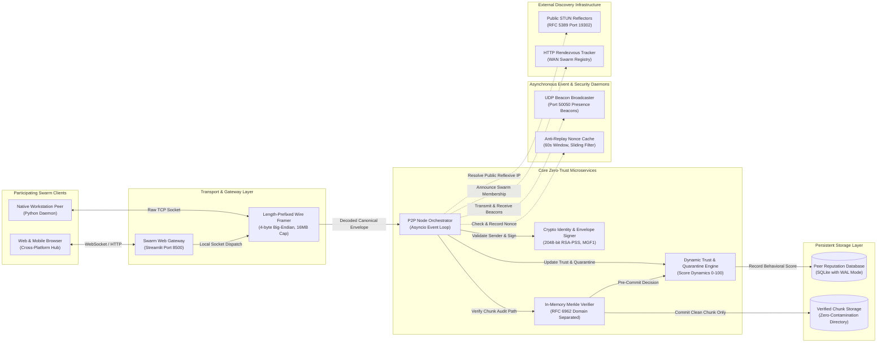
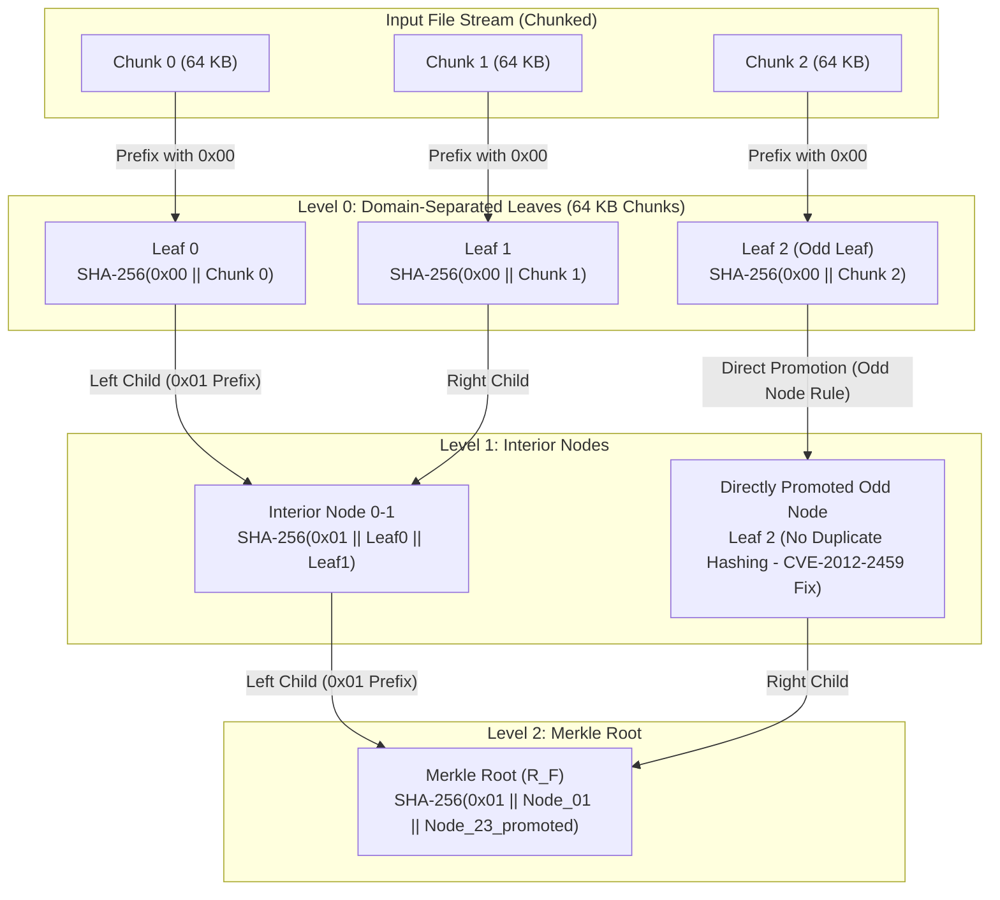
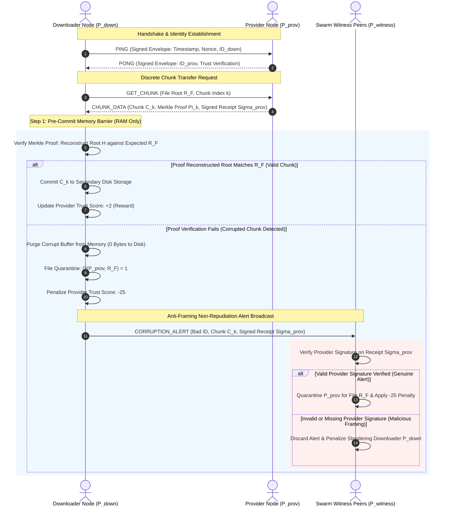
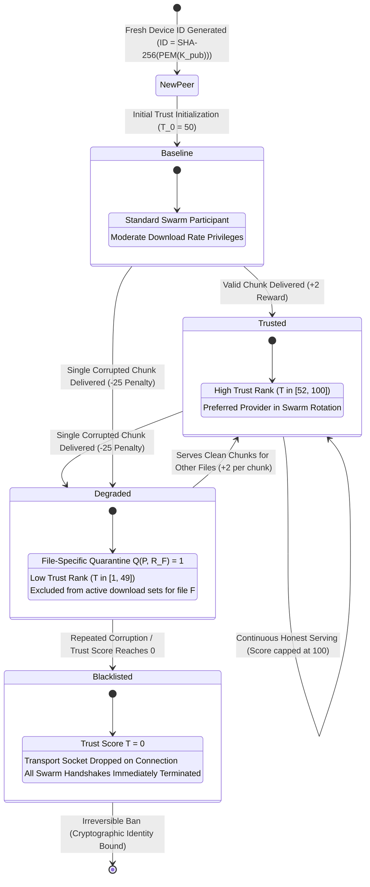

# Architecture & System Diagrams for Zero-Trust P2P Network

This directory contains the production-grade architectural and protocol diagrams designed specifically for **academic research papers (IEEE format)** and **conference / project slide presentations**.

---

## Diagram Index

1. **System Architecture Diagram (`system_architecture.mmd`):**
   - **Type:** Software Infrastructure Architecture Flowchart (Left-to-Right).
   - **Purpose:** Full end-to-end view showing clients, transport framer, core P2P microservices, SQLite reputation datastore, zero-contamination chunk storage, async UDP/nonce daemons, and external STUN/Bootstrap infrastructure.
   - **Best For:** Paper Section III (*System Architecture*) and Overview presentation slide.

2. **RFC 6962 Domain-Separated Merkle Tree (`merkle_verification.mmd`):**
   - **Type:** Hierarchical Tree Flowchart.
   - **Purpose:** Visualizes discrete 64 KB chunks, `0x00` leaf domain separation, `0x01` interior node domain separation, and direct odd-node promotion preventing second pre-image attacks (CVE-2012-2459 mitigation).
   - **Best For:** Paper Section III-B (*Merkle Verification*) and Cryptographic Design slide.

3. **In-Memory Pre-Commit & Anti-Framing Protocol (`protocol_sequence.mmd`):**
   - **Type:** UML Sequence Diagram with Autonumbering.
   - **Purpose:** Step-by-step transaction flow between Downloader, Provider, and Swarm Witnesses showing in-memory pre-commit verification barrier, zero disk contamination, and signed receipt ($\Sigma_{prov}$) verification against malicious slander/framing.
   - **Best For:** Paper Section III-C (*Reputation & Anti-Framing*) and Protocol Walkthrough slide.

4. **Dynamic Peer Reputation & Quarantine State Machine (`reputation_state_machine.mmd`):**
   - **Type:** UML State Diagram (`stateDiagram-v2`).
   - **Purpose:** Illustrates state transitions across Baseline ($T_0=50$), Trusted ($[52, 100]$), Degraded/Quarantined ($[1, 49]$), and permanent Blacklist ($T=0$) with socket termination.
   - **Best For:** Paper Section III-C (*Reputation Engine*) and Security Mitigation slide.

---

## 1. System Architecture Diagram



---

## 2. RFC 6962 Domain-Separated Merkle Tree & Odd-Node Promotion



---

## 3. In-Memory Pre-Commit & Anti-Framing Protocol Sequence



---

## 4. Dynamic Peer Reputation & Quarantine State Machine



---

## 5. How to Embed in IEEE LaTeX Papers

Use the standard `figure` environment in your LaTeX paper:

```latex
\begin{figure*}[htbp]
\centering
\includegraphics[width=0.95\textwidth]{figures/system_architecture.pdf}
\caption{Overall Zero-Trust P2P system architecture illustrating client connectivity, wire framing, cryptographic validation services, SQLite reputation engine, and dual-mode discovery.}
\label{fig:system_architecture}
\end{figure*}
```

And for a single-column Merkle tree or sequence diagram:

```latex
\begin{figure}[htbp]
\centering
\includegraphics[width=\columnwidth]{figures/merkle_verification.pdf}
\caption{RFC 6962 domain-separated Merkle tree construction featuring direct odd-node promotion to mitigate CVE-2012-2459 pre-image collision attacks.}
\label{fig:merkle_tree}
\end{figure}
```
