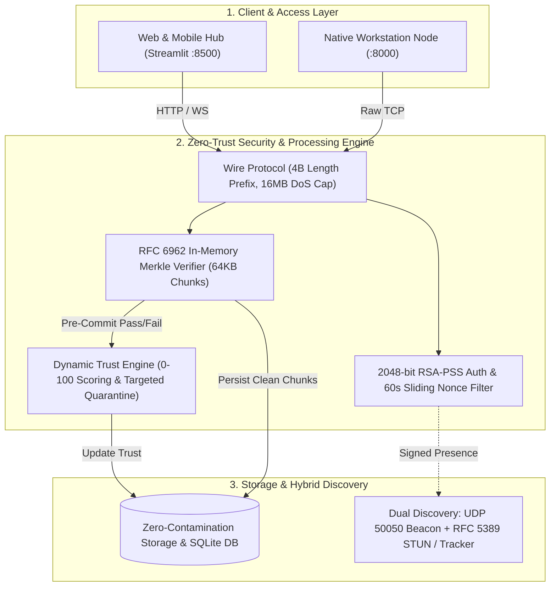
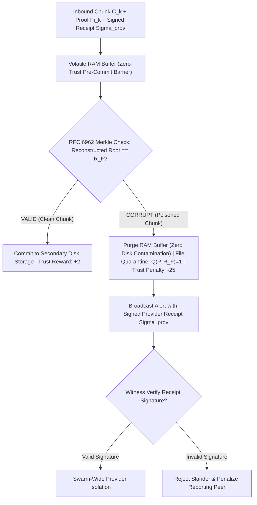
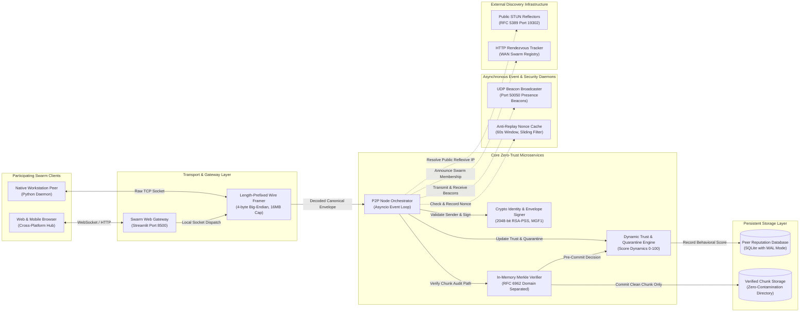
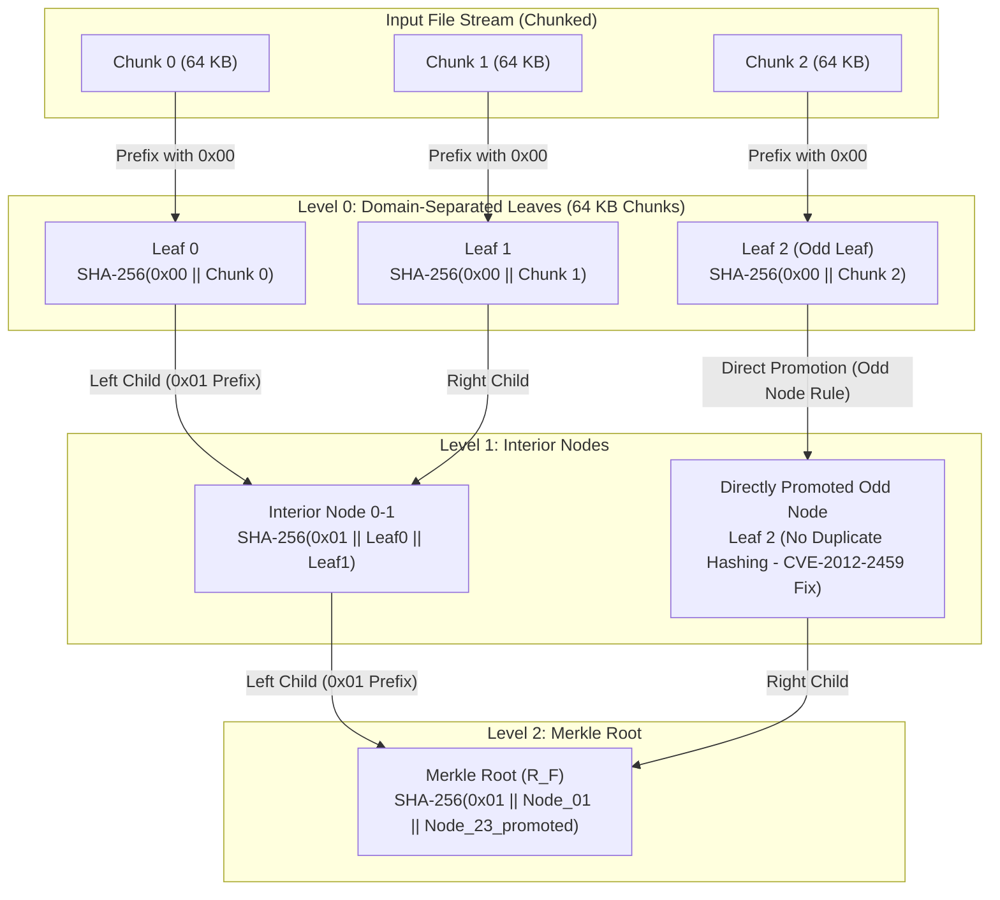
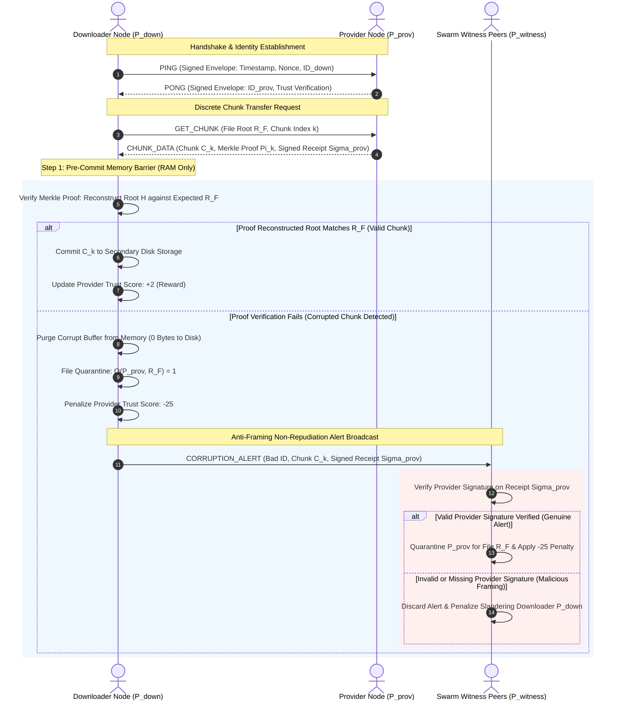
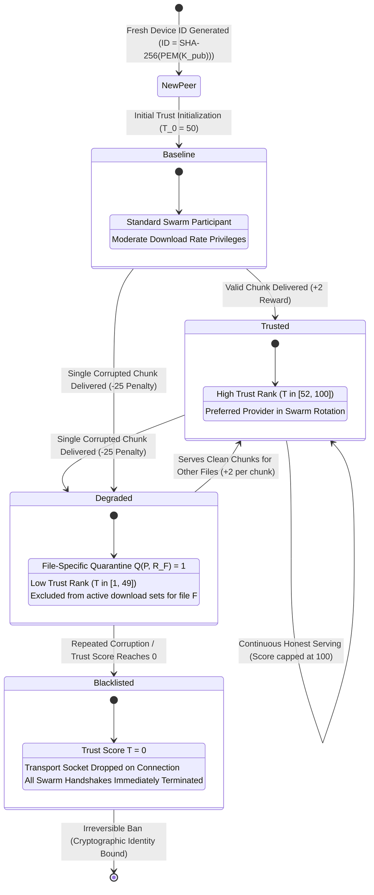

# Space-Efficient Diagrams for IEEE Papers & Slides

In IEEE two-column papers (e.g. 6-page strict limit), **horizontal space is constrained to a single column (~3.5 inches / 88 mm)**. Wide 6-column horizontal diagrams consume excessive page height if stretched or become illegible when shrunk.

To solve this, two **compact, space-optimized diagrams** have been designed specifically to fit within a single column (`\columnwidth`) or a clean slide layout:

1. **Compact 3-Tier System Architecture (`compact_architecture.mmd`):**
   - **FigJam Board:** [Open Compact Architecture in FigJam](https://www.figma.com/online-whiteboard/create-diagram/3bc58890-977e-49f7-abd0-df57e40e9398?utm_source=other&utm_content=edit_in_figjam&oai_id=&request_id=c89c8bcc-4765-453e-9df0-ee3c8eb5bc12)
   - **Height in LaTeX:** Occupies only ~2.2 inches of vertical column space.
2. **Zero-Trust Chunk & Anti-Framing Pipeline (`compact_pipeline.mmd`):**
   - **FigJam Board:** [Open Compact Pipeline in FigJam](https://www.figma.com/online-whiteboard/create-diagram/1be75884-58c5-4de3-a6f5-871a848c8adb?utm_source=other&utm_content=edit_in_figjam&oai_id=&request_id=f6d118b4-bc7e-4f63-b2e4-e01bbe272370)
   - **Height in LaTeX:** Occupies only ~2.0 inches of vertical column space.

---

## Diagram Index & FigJam Links

| Diagram Name | Primary Focus | Best Use Case | Editable FigJam Link |
| :--- | :--- | :--- | :--- |
| **Compact 3-Tier Architecture** | Client, Core Security, Storage & Discovery | Paper Sec. III (Single Column) | [View FigJam](https://www.figma.com/online-whiteboard/create-diagram/3bc58890-977e-49f7-abd0-df57e40e9398?utm_source=other&utm_content=edit_in_figjam&oai_id=&request_id=c89c8bcc-4765-453e-9df0-ee3c8eb5bc12) |
| **Zero-Trust Chunk Pipeline** | In-Memory Barrier & Anti-Framing | Paper Sec. III-B / III-C | [View FigJam](https://www.figma.com/online-whiteboard/create-diagram/1be75884-58c5-4de3-a6f5-871a848c8adb?utm_source=other&utm_content=edit_in_figjam&oai_id=&request_id=f6d118b4-bc7e-4f63-b2e4-e01bbe272370) |
| **Full Horizontal Architecture** | Sprawling Microservices & Daemons | Full-width Slide / Poster | [View FigJam](https://www.figma.com/online-whiteboard/create-diagram/cd80a95f-cde0-4172-b08b-3b9f134b80c2?utm_source=other&utm_content=edit_in_figjam&oai_id=&request_id=820f4e8e-c6c2-4aaf-b0c9-c1ef39308a3a&architecture=true) |
| **RFC 6962 Merkle Tree** | Odd-Node Promotion (CVE-2012-2459) | Paper Sec. III-B | [View FigJam](https://www.figma.com/online-whiteboard/create-diagram/7d413152-4258-491e-a58b-802a03fbbe50?utm_source=other&utm_content=edit_in_figjam&oai_id=&request_id=f61199b5-16b5-4638-ae4f-8f7cc9dcd62b) |
| **Protocol Sequence Diagram** | Transaction Steps & Signed Receipts | Paper Sec. III-A / III-C | [View FigJam](https://www.figma.com/online-whiteboard/create-diagram/cb0019d2-eb38-43e2-a593-676dd20a3c37?utm_source=other&utm_content=edit_in_figjam&oai_id=&request_id=dc02f79e-0c0c-4cec-9595-e83e7c98dbb0) |
| **Reputation State Machine** | Trust Transitions & Socket Drops | Presentation Slide | [View FigJam](https://www.figma.com/online-whiteboard/create-diagram/10b45833-fc6c-4bf9-8b2d-6b98144b1758?utm_source=other&utm_content=edit_in_figjam&oai_id=&request_id=bee914a4-5180-4556-a18e-24b5f25e0dea) |

---

## 1. Compact 3-Tier Architecture Diagram (Single-Column)



---

## 2. Zero-Trust Pipeline & Anti-Framing Workflow (Single-Column)





---

## 2. RFC 6962 Domain-Separated Merkle Tree & Odd-Node Promotion



---

## 3. In-Memory Pre-Commit & Anti-Framing Protocol Sequence



---

## 4. Dynamic Peer Reputation & Quarantine State Machine



---

## 5. How to Embed in IEEE LaTeX Papers

Use the standard `figure` environment in your LaTeX paper:

```latex
\begin{figure*}[htbp]
\centering
\includegraphics[width=0.95\textwidth]{figures/system_architecture.pdf}
\caption{Overall Zero-Trust P2P system architecture illustrating client connectivity, wire framing, cryptographic validation services, SQLite reputation engine, and dual-mode discovery.}
\label{fig:system_architecture}
\end{figure*}
```

And for a single-column Merkle tree or sequence diagram:

```latex
\begin{figure}[htbp]
\centering
\includegraphics[width=\columnwidth]{figures/merkle_verification.pdf}
\caption{RFC 6962 domain-separated Merkle tree construction featuring direct odd-node promotion to mitigate CVE-2012-2459 pre-image collision attacks.}
\label{fig:merkle_tree}
\end{figure}
```
